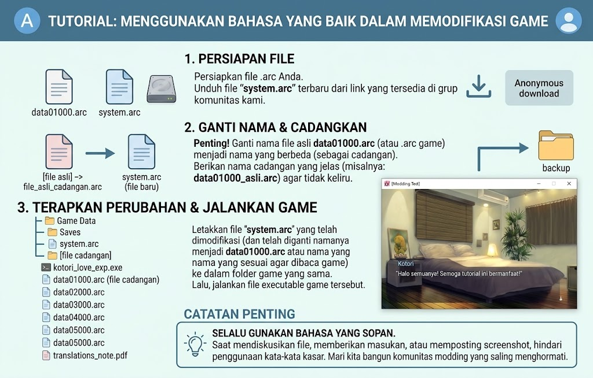

# Kotori Love Exp Patch Tools

Kumpulan alat dan arsip kerja untuk eksperimen modifikasi serta pembuatan patch **Kotori Love Exp**. Repository ini menyimpan paket **BijikTools v0.6-beta2**, arsip data asli dan hasil repack, arsip sistem, serta gambar tutorial berbahasa Indonesia.

**Status:** bahan kerja/eksperimen. Kompatibilitas hasil repack dan arsip sistem dengan setiap versi game belum diverifikasi; repository ini tidak menyatakan bahwa patch terjemahan sudah selesai.

## Isi repository

| File | Keterangan |
| --- | --- |
| `BijikTools-v0.6-beta2.rar` | Paket aplikasi Windows beserta dependensi dan alat pendukung. Ekstrak untuk mengakses `BijikTools.exe`. |
| `data01000_original.arc` | Salinan arsip data asli untuk referensi dan pembanding. Header arsip: `PackFile`. |
| `data01000.entah` | Salinan dengan ekstensi alternatif; isinya identik dengan `data01000_original.arc` berdasarkan SHA-256. |
| `data01000.repacked.arc` | Arsip hasil repack dengan header `BURIKO ARC20`. Formatnya berbeda dari arsip asli, sehingga kecocokannya perlu diuji. |
| `system.arc` | Arsip berheader `PackFile` yang memuat `ipl._bp`, `launcher._bp`, dan `VeraMoBd._ft`. |
| `tutorial.png` | Panduan visual persiapan file, pencadangan, dan penerapan perubahan. |
| `SHA256SUMS.txt` | Checksum enam file distribusi untuk memeriksa keutuhan salinan. |

## Persiapan

- Windows untuk menjalankan aplikasi yang disertakan.
- [7-Zip](https://www.7-zip.org/) atau aplikasi lain yang dapat mengekstrak RAR.
- [.NET Desktop Runtime 8](https://dotnet.microsoft.com/en-us/download/dotnet/8.0), sesuai konfigurasi runtime BijikTools yang disertakan.
- Instalasi Kotori Love Exp sebagai tempat pengujian dan salinan cadangan arsip yang akan diubah.

## Mulai menggunakan

1. Unduh repository melalui **Code → Download ZIP**, atau clone:

   ```powershell
   git clone https://github.com/SakuraSymphonyReTranslation/Kotori-Love-Exp-Patch-Tools.git
   ```

2. Ekstrak `BijikTools-v0.6-beta2.rar` ke folder kerja. Pertahankan susunan folder `lib`, `external`, dan `app` agar file pendukung tetap tersedia.
3. Jalankan `BijikTools.exe` dari folder hasil ekstraksi. Jika Windows meminta runtime, pasang .NET Desktop Runtime 8 yang sesuai.
4. Gunakan salinan arsip asli sebagai bahan kerja dan pembanding saat menyiapkan perubahan. Simpan hasil modifikasi sebagai file terpisah.
5. Uji arsip hasil perubahan pada salinan instalasi game. Nama dan lokasi arsip harus mengikuti file yang dibaca oleh versi game tersebut.
6. Jalankan game dan periksa bagian yang diubah. Jika hasilnya gagal dimuat, pulihkan arsip cadangan sebelum mencoba perubahan berikutnya.

Nama `data01000.repacked.arc` dipertahankan sebagai penanda hasil kerja. Keberadaan file tersebut belum membuktikan bahwa formatnya dapat langsung dimuat oleh game. Demikian juga, jangan menyimpulkan bahwa `system.arc` dan `data01000.arc` dapat saling menggantikan hanya berdasarkan nama pada gambar tutorial.

## Tutorial visual



Gambar ini disertakan sebagai referensi alur kerja. Sesuaikan penamaan file dengan versi game yang diuji; tutorial tidak menggantikan pengujian kompatibilitas arsip.

## Memeriksa file

Di PowerShell, checksum sebuah file dapat diperiksa dengan:

```powershell
Get-FileHash -Algorithm SHA256 -LiteralPath '.\BijikTools-v0.6-beta2.rar'
```

Bandingkan hasilnya dengan entri terkait di `SHA256SUMS.txt`.

## Paket alat dan kredit

Arsip BijikTools menyertakan aplikasi utama, CopasTool, serta komponen pendukung seperti EntisDecryptTool, rosetta, tjs2-decompiler, tjs2Compiler, dan pustaka FreeMote. Daftar ini menjelaskan isi paket; tidak semua komponen tersebut diperlukan untuk Kotori Love Exp.

Repository ini mengarsipkan paket alat yang sudah tersedia, bukan menyediakan seluruh source code BijikTools. Kredit aplikasi, pustaka, dan aset tetap milik pembuat atau pemegang hak masing-masing. Tidak ada lisensi baru yang diterapkan atas komponen pihak ketiga melalui repository ini.

Dikelola oleh [Sakura Symphony Re; Translation](https://github.com/SakuraSymphonyReTranslation).

## English overview

A working collection for Kotori Love Exp patch experiments, containing BijikTools v0.6-beta2, original and repacked data archives, a system archive, and an Indonesian tutorial. The repacked archive uses a different header format from the original. Game compatibility and translation completion have not been verified. Keep backups and test changes on a separate game installation.
